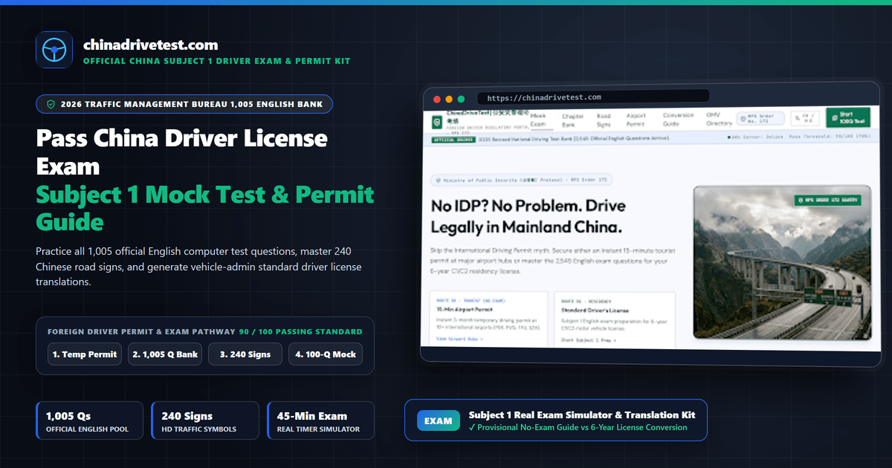
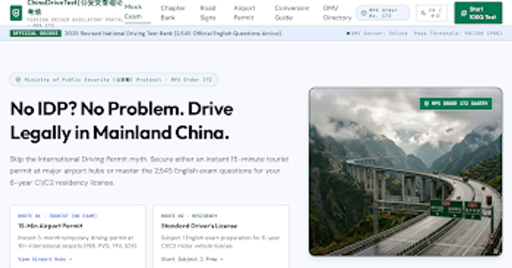
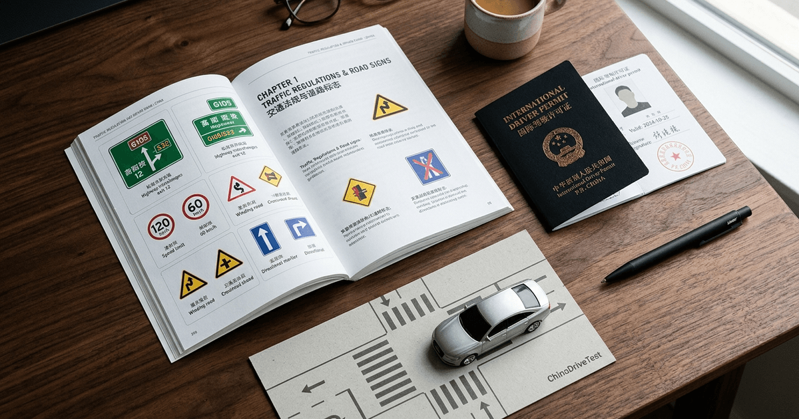

# ChinaDriveTest MCP Server — Subject 1 Exam Bank, Airport Permits & DMV Conversion Engine



## Overview & Production Architecture

**ChinaDriveTest** ([https://chinadrivetest.com](https://chinadrivetest.com)) exposes a stateless, zero-authentication **Model Context Protocol (MCP)** server (`streamable-http` at `https://chinadrivetest.com/api/mcp`) backed by the complete **2,545-question bilingual China Subject 1 driving exam corpus**, a **SuperMemo-2 (SM-2)** spaced repetition grader, **Ministry of Public Security Order No. 172** bilateral treaty checks (`FR, BE, AE, RS, HK, MO`), 9 international airport 15-minute temporary permit desks (`PVG, SHA, PEK, PKX, TFU, SYX, HAK, SZX, URC`), 5 municipal DMV conversion walkthroughs (`Shanghai, Beijing, Shenzhen, Guangzhou, Chengdu`), 25 GB5768 road signs & 8 police hand gestures, a deterministic 3-character DMV Chinese name translator, and 3 flagship self-drive route dossiers. All 8 tools are public, deterministic, and annotated `readOnlyHint: true` with zero API keys required.



## Available MCP Tools (8 Read-Only Tools)

| Tool Name | Purpose & Deterministic Engine | Key Parameters | Safety |
| :--- | :--- | :--- | :---: |
| `search_subject1_exam_questions` | Filter the full 2,545-question Mainland China driving theory exam corpus by English or Chinese keyword, topic chapter, difficulty rating, and his | `keyword`, `chapterSlug`, `questionType`, `minDifficulty` (+2 more) | `readOnly` |
| `grade_mock_exam_and_sm2_schedule` | Score candidate answer sheets against the 90/100 statutory pass cutoff while computing updated SuperMemo-2 review intervals, or generate a weight | `submissions`, `generateDrillCount`, `chapterSlug`, `includeAnswerKey` | `readOnly` |
| `evaluate_foreign_license_conversion_and_mutual_swap` | Determine whether an overseas driver qualifies for a zero-exam bilateral swap across 6 treaty jurisdictions, a 15-minute airport tourist permit,  | `issuingJurisdiction`*, `stayDurationDays`, `holdsChinaResidencePermit`, `applicantAge` | `readOnly` |
| `query_airport_temporary_permit_counter` | Look up on-arrival Traffic Police service desks across 9 international airports (PVG, SHA, PEK, PKX, TFU, SYX, HAK, SZX, URC), returning terminal | `airportQuery`*, `includeArrivalSteps`, `includeRentalBays` | `readOnly` |
| `query_city_dmv_conversion_guide` | Retrieve exact street addresses, subway access, Traffic Management 12123 booking rules, bilingual taxi direction cards, and window workflows for  | `citySlug`*, `includeHallSteps`, `includeBranchDirectory` | `readOnly` |
| `generate_dmv_license_translation_and_class_map` | Convert overseas license categories to PRC C1, C2, or E/D equivalents, deterministically synthesize an official 3-character Chinese applicant nam | `fullName`*, `gender`, `foreignLicenseClass`, `issuingCountry` (+2 more) | `readOnly` |
| `lookup_chinese_road_signs_and_demerit_points` | Inspect 25 visual traffic warning, prohibition, mandatory, and directional signs plus 8 official police hand gestures alongside Order No. 172 dem | `category`, `keyword`, `demeritPointsFilter` | `readOnly` |
| `plan_china_self_drive_route_and_rental` | Compile logistics for Duku Highway (G217), Western Sichuan (G318), and Hainan Ring Road itineraries including altitude hazards, foreign passport  | `routeSlug`*, `includeDayByDayItinerary`, `includeRentalAgencies` | `readOnly` |

## Live JSON-RPC 2.0 Verification Sample

Request (`POST https://chinadrivetest.com/api/mcp`):

```bash
curl -s -X POST https://chinadrivetest.com/api/mcp \
  -H "Content-Type: application/json" \
  -d '{"jsonrpc":"2.0","id":1,"method":"tools/call","params":{"name":"evaluate_foreign_license_conversion_and_mutual_swap","arguments":{"issuingJurisdiction":"France","stayDurationDays":180,"holdsChinaResidencePermit":true,"applicantAge":34}}}'
```

Verified Production Response:

```json
{
  "sourceDataset": "lib/driving-rules.ts (MPS Order No. 172)",
  "mpsOrderInfo": {
    "orderNumber": "Order No. 172",
    "orderName": "Provisions on the Application and Use of Motor Vehicle Driving Licenses",
    "orderNameZh": "机动车驾驶证申领和使用规定（公安部令第172号）",
    "effectiveDate": "2025-01-01",
    "keyHighlights": [
      "Temporary driving permits for tourists issued on arrival without written tests or hospital medical physicals (15 min at international airports).",
      "Bilateral mutual recognition drivers license swap with 6 jurisdictions (France, Belgium, UAE, Serbia, Hong Kong, Macau) with ZERO exams.",
      "Conversion to full 6-year C1/C2 license for long-term residents requires ONLY Subject 1 theory (100 Qs, 45 min, 90/100 to pass). No road test.",
      "No upper age limit for passenger cars (C1/C2). Drivers aged 70+ take the cognitive \"Three Abilities\" (Memory, Judgment, Reaction) test.",
      "Commercial driving license age limit extended to 63 years (elastic extension up to 66 years for qualifying bus/truck drivers)."
    ]
  },
  "issuingJurisdiction": "France",
  "qualifiesZeroExamMutualSwap": true,
  "mutualRecognitionTreaty": {
    "country": "France",
    "countryZh": "法国",
    "code": "FR",
    "agreementDate": "2021-08-17",
    "rules": "Direct swap to C1/C2 without written exam (Subject 1) or road test. Both permanent residents and temporary visitors can drive or swap directly.",
    "documents": [
      "French Driving License (Permis de conduire)",
      "Certified Chinese Translation",
      "Valid Passport & Visa/Residence Permit",
      "Medical Declaration Form"
    ]
  },
  "allSixMutualRecognitionJurisdictions": [
    "FR (France)",
    "BE (Belgium)",
    "AE (United Arab Emirates)",
    "RS (Serbia)",
    "HK (Hong Kong SAR)",
    "MO (Macau SAR)"
  ],
  "recommendedPathway": "direct_bilateral_mutual_swap_zero_exam",
  "internationalDrivingPermitNotice": "China is NOT a contracting party to the 1949/1968 IDP conventions. Foreigners CANNOT drive in Mainland China on an IDP alone.",
  "agePolicyCheck": {
    "applicantAge": 34,
    "c1c2UpperAgeLimit": "No upper age limit under MPS Order No. 172",
    "requiresThreeAbilitiesCognitiveTest": false,
    "commercialBusTruckAgeCeiling": "Extended to 63 (up to 66 with elastic extension)"
  },
  "permitVsFullLicenseComparison": {
    "touristPermit": {
      "name": "Temporary Driving Permit (临时机动车驾驶许可)",
      "targetAudience": "Tourists, business visitors, family visits (Stay <= 3 months, extendable to 1 year)",
      "examRequirement": "EXEMPT - Zero exams (No Subject 1, No road test)",
      "medicalCheck": "EXEMPT - Simply sign physical self-declaration form",
      "processingLocation": "Airport counter, border port service station, or local DMV",
      "timeToIssue": "10 to 20 minutes on arrival",
      "costRmb": "¥10 RMB statutory administrative fee",
      "validity": "3 months (or matches the entry visa duration, up to 1 year max)",
      "vehicleClass": "Small passenger cars (C1 manual / C2 automatic), typically rental cars",
      "allowedVehicles": "Rental cars from licensed rental agencies or borrowed private vehicles"
    },
    "expatLicense": {
      "name": "Official 6-Year Chinese Driver’s License (中华人民共和国机动车驾驶证)",
      "targetAudience": "Expats with Residence Permits (Work, Study, Family Reunion) staying > 6 months",
      "examRequirement": "Subject 1 Theory Exam ONLY (100 questions, 45 minutes, 90/100 to pass). Subjects 2 & 3 road tests are waived.",
      "medicalCheck": "Mandatory standard physical check at designated DMV health clinic (~¥30, takes 10 min)",
      "processingLocation": "Municipal Vehicle Management Office (车管所 - Cheguansuo)",
      "timeToIssue": "Same-day or next-day after passing the Subject 1 exam",
      "costRmb": "Exam fee ~¥40–¥80 + License card fee ¥10 RMB",
      "validity": "6 years initially (Renewable to 10-year and lifelong with clean record)",
      "vehicleClass": "C1 (Manual & Automatic) or C2 (Automatic Only)",
      "allowedVehicles": "Any privately owned or rented Chinese-registered passenger vehicle"
    }
  },
  "officialGuideUrl": "https://chinadrivetest.com/license-conversion"
}
```

## Quick Client Configuration (Claude Desktop / Cursor / Windsurf / Hermes)

```json
{
  "mcpServers": {
    "chinadrivetest": {
      "type": "streamable-http",
      "url": "https://chinadrivetest.com/api/mcp"
    }
  }
}
```

Or inspect directly from any Node.js terminal via the pinned official CLI:

```bash
npx -y chinadrivetest-cli@1.0.0 tools
npx -y chinadrivetest-cli@1.0.0 demo
```

## Statutory Compliance & Exam Benchmarks

### Tourist Temporary Permit vs Expat 6-Year Full License (MPS Order No. 172)

| Credential Type | Exam & Medical Requirement | Statutory Fee & Issuance Time | Validity & Vehicle Scope |
| :--- | :--- | :---: | :--- |
| **Temporary Driving Permit (临时驾驶许可)** | **Zero exam** & no hospital check (signed health form) | **¥10 RMB** · `10–20 min` at Airport | Up to 3 months per entry (1 yr max) for rental C1/C2 cars |
| **Full Chinese License (C1/C2 驾驶证)** | **Subject 1 theory only** (100 Qs, 45m, 90/100) | ~¥50–¥90 RMB · Same/next day | **6 years initial** (10-year/lifelong on clean renewal); owned/rented cars |
| **Bilateral Mutual Swap (`FR/BE/AE/RS/HK/MO`)** | **Exempt from Subject 1 & road tests** | ¥10–¥50 RMB · Same day | Immediate direct exchange upon translation + medical check |

### International Airport 15-Minute Temporary Driving Permit Desks

| Airport & IATA Code | Exact Terminal Service Station | Daily Operating Hours | Processing Fee |
| :--- | :--- | :---: | :---: |
| **Shanghai Pudong (`PVG`)** | T2 Five Continents Middle Walkway near Maglev | `09:00 – 17:00` Daily | ¥10 RMB |
| **Beijing Capital (`PEK`)** | T3-C 2nd Floor Traffic Management Station | `08:30 – 17:00` Daily | ¥10 RMB |
| **Beijing Daxing (`PKX`)** | 1st Floor International Arrivals near Gate 16 | `09:00 – 17:00` Daily | ¥10 RMB |
| **Sanya Phoenix (`SYX`)** | Hainan FTP Arrivals Exit Licensing Hub | `08:30 – 20:00` Daily | ¥10 RMB (`10 min`) |
| **Chengdu Tianfu (`TFU`)** | T1 Ground Transportation Center (GTC) | `09:00 – 17:30` Daily | ¥10 RMB |

### Subject 1 Question Bank & MPS Order No. 172 Demerit Point Severities

| Official Exam Chapter / Offense Tier | Statutory Items / Scope | Critical Compliance Cutoff |
| :--- | :---: | :--- |
| **Traffic Signs, Markings & Signals (`723 Qs`)** | Yellow warning triangles, red prohibition circles, blue circles | 90/100 required in 45 min Subject 1 computer exam |
| **12-Point Severe Offenses** | DUI, hit-and-run minor injury, fake plates, `>=50%` expressway speeding | Immediate suspension + mandatory 7-day retraining exam |
| **6-Point Moderate Offenses** | Running red lights, emergency lane driving, `20%–50%` expressway speed | Triggered automatically by expressway AI gantries |

## Technical Architecture & Editorial Reference



## Official Web Tools & Study Guides

- **[ChinaDriveTest Official Portal — Subject 1 & China Driving License Prep Hub](https://chinadrivetest.com)** — `https://chinadrivetest.com`
- **[Official 100-Question China Subject 1 Mock Exam Simulator (90/100 Pass)](https://chinadrivetest.com/mock-test)** — `https://chinadrivetest.com/mock-test`
- **[Subject 1 Numbers, Speed Limits & Order No. 172 Demerit Points Cheat Sheet](https://chinadrivetest.com/cheat-sheet)** — `https://chinadrivetest.com/cheat-sheet`
- **[15-Minute China Airport Temporary Driving Permit Guide (No Exam Required)](https://chinadrivetest.com/temporary-permit)** — `https://chinadrivetest.com/temporary-permit`
- **[Chinese GB5768 Road Signs, Markings & Traffic Police Hand Signals Guide](https://chinadrivetest.com/road-signs)** — `https://chinadrivetest.com/road-signs`
- **[Foreign Driver License to 6-Year Chinese C1/C2 Conversion Guide](https://chinadrivetest.com/license-conversion)** — `https://chinadrivetest.com/license-conversion`
- **[Official Chinese Driver License Translation Template & Name Generator](https://chinadrivetest.com/license-translation-template)** — `https://chinadrivetest.com/license-translation-template`
- **[Can You Drive in China with an International Driving Permit (IDP)?](https://chinadrivetest.com/international-driving-permit-china)** — `https://chinadrivetest.com/international-driving-permit-china`
- **[Renting a Car in China as a Foreigner (Alipay, Deposits & Agencies)](https://chinadrivetest.com/car-rental)** — `https://chinadrivetest.com/car-rental`
- **[Iconic China Self-Drive Road Trips (Duku G217, Sichuan G318 & Hainan)](https://chinadrivetest.com/road-trips)** — `https://chinadrivetest.com/road-trips`

## License

MIT License — maintained by **[ChinaDriveTest](https://chinadrivetest.com)**.
